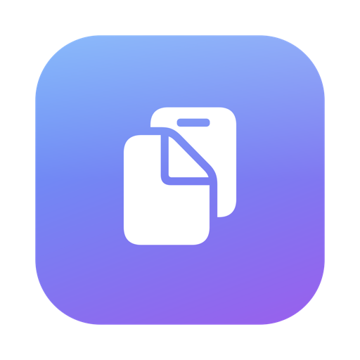
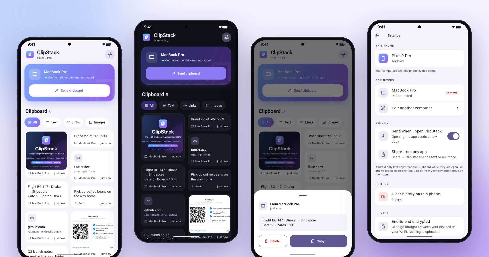
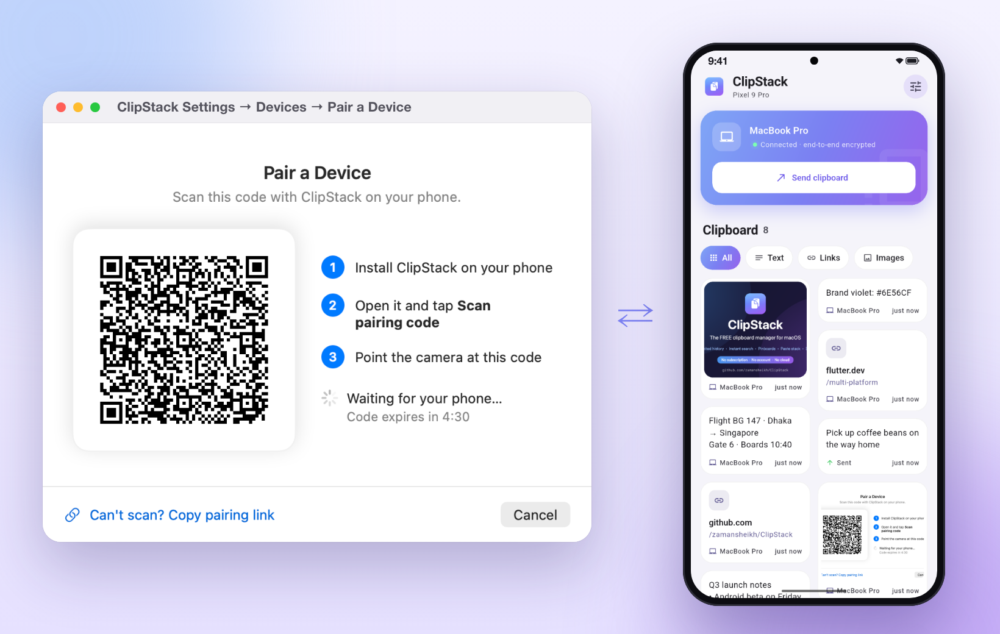

<div align="center">



# ClipStack

**A free, native clipboard manager for macOS — now with Wi-Fi sync to your Android phone.**

[](https://github.com/zamansheikh/ClipStack/releases/latest)
[](#requirements)
[](#-android-app)
[](https://swift.org)
[](https://flutter.dev)
[](LICENSE)

Everything you copy — text, links, images, files — captured silently, searchable forever,
and pasteable anywhere with one keystroke. Copy on your Mac, paste on your phone, and back:
clips travel straight between your devices over your own Wi-Fi, end-to-end encrypted.
No subscription, no account, no cloud.

[**⬇ Download for Mac**](https://github.com/zamansheikh/ClipStack/releases/latest) &nbsp;·&nbsp; [**📱 Android app**](#-android-app)

</div>

<p align="center">
  
</p>

---

## ✨ Features

### On your Mac

- 📋 **Unlimited clipboard history** — every copy is captured automatically: plain & rich text, links, images, and files, with source-app attribution.
- ⌨️ **Overlay paste board** — press `⌘⇧V` for a bottom-anchored overlay of preview cards. It never steals focus, so pasting lands exactly where you were typing.
- 🔍 **Instant full-text search** — type to search your *entire* history (SQLite FTS5, prefix matching), with Text / Links / Images / Files filter chips.
- 📌 **Pins & pinboards** — pin anything (`⌘P`) so it never expires; organize pins into named boards (email templates, snippets, addresses…).
- 📚 **Paste stack** — `⌘`-click multiple cards, hit `Return`, and they paste sequentially — perfect for filling forms.
- 👁️ **Preview & edit** — `Space` opens a full-size preview; edit text clips in place before pasting.
- 🔒 **Privacy first** — password-manager copies are never recorded (honors concealed/transient clipboard flags), you can exclude any app entirely, and everything stays in a local SQLite database. No telemetry.
- ⏱️ **Retention controls** — auto-delete history after 1 hour → 1 month, cap item count or size, clear by category. Pinned clips always survive.
- ⚙️ **Native & lightweight** — Swift + SwiftUI menu bar app, launch at login, remappable hotkey.

### 📱 Across your devices

- 🔁 **Mac → phone, automatically** — anything you copy on your Mac lands on your phone's clipboard, ready to paste.
- 📤 **Phone → Mac in one tap** — tap **Send clipboard**, use **Share → ClipStack** from any app, or just open ClipStack and it sends your latest copy.
- 🖼️ **Images too** — copy a screenshot on your Mac and paste it into any chat on your phone; share a photo from your phone to your Mac's clipboard.
- 🔐 **Private by design** — devices talk directly on your local network. Every connection is end-to-end encrypted (X25519 + ChaCha20-Poly1305), pairing uses a one-time QR code, and nothing is uploaded anywhere.
- 📱↔📱 **Phone to phone** — pair two phones directly: one taps **Show my pairing code**, the other scans it. No computer needed.
- 🏷️ **Know where it came from** — clips from your phone show a phone badge in your Mac's history.

<p align="center">
  
</p>

## ⌨️ Keyboard shortcuts

| Key | Action |
|-----|--------|
| `⌘⇧V` | Open / close the overlay (remappable) |
| `←` `→` | Navigate cards |
| `Return` | Paste into the frontmost app |
| `⇧Return` | Paste as plain text |
| `⌘1`–`⌘9` | Quick-paste item 1–9 |
| `Space` | Full-size preview (and edit text) |
| `⌘P` | Pin / unpin |
| `⌘C` | Copy without pasting |
| `⌘⌫` | Delete clip |
| `⌘click` | Add to paste stack |
| `Tab` | Cycle History → Pinned → pinboards |
| `Esc` | Dismiss |

## 📦 Install

### Mac

1. Download the latest `ClipStack-x.y.z.zip` from [**Releases**](https://github.com/zamansheikh/ClipStack/releases/latest), unzip, and move **ClipStack.app** to **Applications**.
2. The app isn't notarized by Apple yet, so macOS blocks the first launch. Paste this one command in **Terminal** and press Enter:

   ```sh
   xattr -d com.apple.quarantine /Applications/ClipStack.app
   ```

3. Open ClipStack (it lives in your menu bar) and press `⌘⇧V`.
4. *Optional:* grant the **Accessibility** permission when asked so items paste directly into other apps — or skip it and use copy-only mode.

### 📱 Android app

ClipStack for Android is on its way to Google Play. Until then, build it from source (see below) and:

1. On your Mac, open **ClipStack → Settings → Devices**, turn on **Share clipboard over Wi-Fi**, and click **Pair a Device…**.
2. In the Android app, tap **Pair with your computer** and scan the QR code.
3. Copy something on your Mac — it's on your phone. To send from the phone, tap **Send clipboard** or use **Share → ClipStack**.

> Android only lets apps read the clipboard while they're open, so sending *from* the phone takes one tap. Receiving from the Mac is automatic, even in the background.

### Requirements

- **Mac:** macOS 14 (Sonoma) or later, Apple Silicon.
- **Android:** Android 7.0 or later.
- **Sync:** both devices on the same Wi-Fi network. Some guest, hotel and campus networks block devices from seeing each other.

## 🛠 Building from source

**Mac app** — requires Xcode 16+ and [XcodeGen](https://github.com/yonaskolb/XcodeGen):

```sh
brew install xcodegen
git clone https://github.com/zamansheikh/ClipStack.git
cd ClipStack
xcodegen generate
open ClipStack.xcodeproj   # then ⌘R
```

The `.xcodeproj` is generated — edit [`project.yml`](project.yml), not the project file. To keep the
Accessibility permission across rebuilds, sign with your own certificate via
`Config/Signing.local.xcconfig` (see [`Config/Signing.xcconfig`](Config/Signing.xcconfig)).

**Android app** — requires [Flutter](https://flutter.dev) 3.50+:

```sh
cd clients/clipstack_app
flutter run --release
```

**Sync protocol tests:**

```sh
cd clients/clipstack_sync
dart test
```

## 🗂 Project layout

| Path | What's there |
|------|--------------|
| [`ClipStack/`](ClipStack) | macOS app — Swift, SwiftUI, GRDB |
| [`ClipStack/Sync/`](ClipStack/Sync) | Wi-Fi sync on the Mac: Bonjour listener, pairing, encrypted sessions |
| [`clients/clipstack_sync/`](clients/clipstack_sync) | Pure-Dart sync protocol package + command-line test peer |
| [`clients/clipstack_app/`](clients/clipstack_app) | Flutter app (Android today; iOS, Windows and Linux next) |
| [`docs/`](docs) | Specs, roadmap, sync protocol, store assets |

## 🗺 Roadmap & docs

| Doc | Purpose |
|-----|---------|
| [docs/01-overview.md](docs/01-overview.md) | Vision & goals |
| [docs/02-feature-spec.md](docs/02-feature-spec.md) | Full feature specification |
| [docs/03-architecture.md](docs/03-architecture.md) | Tech stack, macOS APIs, data model |
| [docs/04-roadmap.md](docs/04-roadmap.md) | Phased plan — Phases 0–2 complete ✅, Phase 3 (Wi-Fi sync) under way |
| [docs/05-lan-sync.md](docs/05-lan-sync.md) | Wi-Fi sync protocol v1: discovery, pairing, encryption, test hooks |
| [docs/store/](docs/store) | Google Play listing graphics and how to regenerate them |

**Up next:** ClipStack on Google Play, the iPhone app, Windows & Linux desktop apps, and Developer ID signing + notarization for the Mac (no more Terminal command).

## 🤝 Contributing

Issues and pull requests are welcome! If you'd like to help:

1. Check the [roadmap](docs/04-roadmap.md) and [open issues](https://github.com/zamansheikh/ClipStack/issues) for ideas.
2. Fork, create a feature branch, and open a PR against `main`.
3. For larger changes, open an issue first so we can discuss the approach.

## ☕ Support the project

ClipStack is free and always will be. If it saves you a subscription, consider buying me a coffee — it funds the Apple Developer account that will make installs one-click (signing + notarization) and the Google Play listing.

<p>
<a href="https://ko-fi.com/zamansheikh"></a>
&nbsp;
<a href="https://buymeacoffee.com/zamansheikh"></a>
</p>

## 📄 License

[MIT](LICENSE) © Zaman Sheikh

> **Naming note:** "ClipStack" is a working title — trademark / App Store availability not yet verified. ClipStack replicates *features* of commercial clipboard managers, not their branding.
